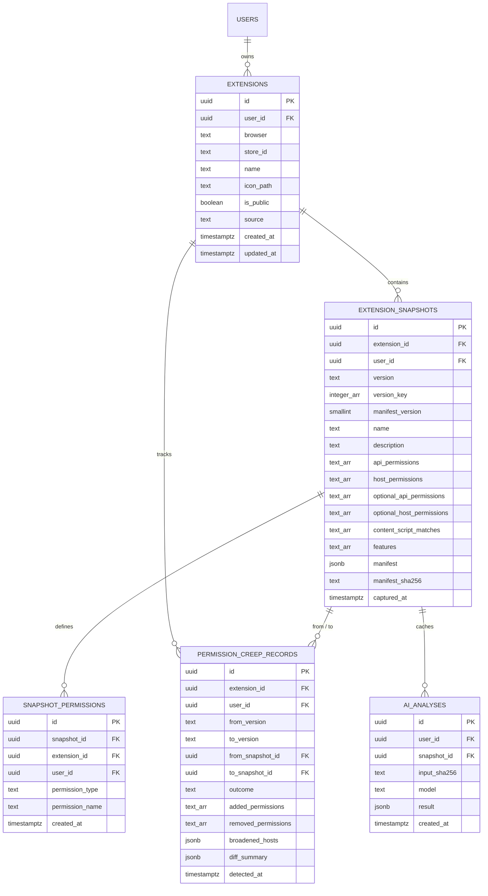

# AEGIS Database Specification & Data Dictionary

This document defines the production PostgreSQL/Supabase schema for AEGIS, including tables, integrity constraints, indices, audit triggers, storage bucket configuration, and Row-Level Security (RLS) policies.

---

## 1. Entity-Relationship Diagram

---

## 2. Table Catalog

### 2.1 `public.extensions`
Root entity tracking an inspected browser extension associated with a user or public catalogue record.

| Column | Type | Constraints / Defaults | Description |
|---|---|---|---|
| `id` | `uuid` | `PRIMARY KEY DEFAULT gen_random_uuid()` | Unique surrogate identifier |
| `user_id` | `uuid` | `NOT NULL DEFAULT auth.uid() REFERENCES auth.users(id) ON DELETE CASCADE` | Owning Supabase Auth user |
| `browser` | `text` | `NOT NULL CHECK (browser IN ('chrome','edge','firefox','brave','opera','other'))` | Target browser engine |
| `store_id` | `text` | `CHECK (store_id ~ '^[A-Za-z0-9._@{}-]{1,128}$')` | Web store extension ID |
| `name` | `text` | `NOT NULL CHECK (char_length(name) BETWEEN 1 AND 200)` | Extension display title |
| `icon_path` | `text` | `CHECK (char_length(icon_path) <= 300)` | Private storage object path |
| `is_public` | `boolean` | `NOT NULL DEFAULT false` | Public catalog flag (read-accessible to anon) |
| `source` | `text` | `NOT NULL DEFAULT 'user' CHECK (source IN ('user','catalog_seed','fixture'))` | Data origin provenance |
| `created_at` | `timestamptz` | `NOT NULL DEFAULT now()` | Ingestion timestamp |
| `updated_at` | `timestamptz` | `NOT NULL DEFAULT now()` | Last update timestamp |

**Indices & Constraints:**
- `UNIQUE (id, user_id)`: Composite key for cascading child foreign keys.
- `UNIQUE INDEX extensions_user_store_uq ON extensions (user_id, browser, store_id) WHERE store_id IS NOT NULL`.
- `INDEX extensions_user_idx ON extensions (user_id)`.
- `INDEX extensions_public_idx ON extensions (is_public) WHERE is_public = true`.

---

### 2.2 `public.extension_snapshots`
Append-only immutable record of an extension manifest at a specific version point.

| Column | Type | Constraints / Defaults | Description |
|---|---|---|---|
| `id` | `uuid` | `PRIMARY KEY DEFAULT gen_random_uuid()` | Snapshot surrogate identifier |
| `extension_id` | `uuid` | `NOT NULL` | Parent extension ID |
| `user_id` | `uuid` | `NOT NULL DEFAULT auth.uid()` | Owning user ID |
| `version` | `text` | `NOT NULL CHECK (char_length(version) BETWEEN 1 AND 64)` | Manifest version string |
| `version_key` | `integer[]` | `NULLABLE` | Parsed numeric tuple for sorting (e.g. `{2, 4, 0}`) |
| `manifest_version` | `smallint` | `NOT NULL CHECK (manifest_version IN (2, 3))` | Manifest specification version |
| `name` | `text` | `NOT NULL CHECK (char_length(name) BETWEEN 1 AND 200)` | Snapshot extension title |
| `description` | `text` | `CHECK (char_length(description) <= 2000)` | Declared description |
| `api_permissions` | `text[]` | `NOT NULL DEFAULT '{}' CHECK (cardinality(api_permissions) <= 500)` | Requested API permissions |
| `host_permissions` | `text[]` | `NOT NULL DEFAULT '{}' CHECK (cardinality(host_permissions) <= 500)` | Requested host match patterns |
| `optional_api_permissions` | `text[]` | `NOT NULL DEFAULT '{}' CHECK (cardinality(optional_api_permissions) <= 500)` | Optional runtime API permissions |
| `optional_host_permissions` | `text[]` | `NOT NULL DEFAULT '{}' CHECK (cardinality(optional_host_permissions) <= 500)` | Optional runtime host match patterns |
| `content_script_matches` | `text[]` | `NOT NULL DEFAULT '{}' CHECK (cardinality(content_script_matches) <= 500)` | Content script injection host matches |
| `features` | `text[]` | `NOT NULL DEFAULT '{}' CHECK (cardinality(features) <= 50)` | Structural capabilities detected |
| `manifest` | `jsonb` | `NOT NULL` | Sanitized original manifest (capped at 256 KB) |
| `manifest_sha256` | `text` | `NOT NULL CHECK (manifest_sha256 ~ '^[0-9a-f]{64}$')` | Content SHA-256 digest |
| `captured_at` | `timestamptz` | `NOT NULL DEFAULT now()` | Ingestion timestamp |

**Indices & Constraints:**
- `FOREIGN KEY (extension_id, user_id) REFERENCES public.extensions (id, user_id) ON DELETE CASCADE`.
- `UNIQUE (extension_id, version)`: Enforces append-only deduplication per version.
- `UNIQUE (id, user_id)`: Enables cascade checks.
- `INDEX snapshots_ext_idx ON extension_snapshots (extension_id, version_key DESC NULLS LAST, captured_at DESC)`.

---

### 2.3 `public.snapshot_permissions`
Normalized lookup table for individual permission entries per snapshot. Synchronized automatically via database trigger.

| Column | Type | Constraints / Defaults | Description |
|---|---|---|---|
| `id` | `uuid` | `PRIMARY KEY DEFAULT gen_random_uuid()` | Primary identifier |
| `snapshot_id` | `uuid` | `NOT NULL` | Target snapshot |
| `extension_id` | `uuid` | `NOT NULL` | Parent extension |
| `user_id` | `uuid` | `NOT NULL DEFAULT auth.uid()` | Owning user |
| `permission_type` | `text` | `NOT NULL CHECK (permission_type IN ('api','host','optional_api','optional_host','content_script'))` | Classification tier |
| `permission_name` | `text` | `NOT NULL CHECK (char_length(permission_name) BETWEEN 1 AND 2048)` | Match pattern or API identifier |
| `created_at` | `timestamptz` | `NOT NULL DEFAULT now()` | Record timestamp |

---

### 2.4 `public.permission_creep_records`
Immutable comparison log between two snapshots of an extension.

| Column | Type | Constraints / Defaults | Description |
|---|---|---|---|
| `id` | `uuid` | `PRIMARY KEY DEFAULT gen_random_uuid()` | Primary identifier |
| `extension_id` | `uuid` | `NOT NULL` | Parent extension |
| `user_id` | `uuid` | `NOT NULL DEFAULT auth.uid()` | Owning user |
| `from_version` | `text` | `NOT NULL CHECK (char_length(from_version) BETWEEN 1 AND 64)` | Baseline version string |
| `to_version` | `text` | `NOT NULL CHECK (char_length(to_version) BETWEEN 1 AND 64)` | Compared target version string |
| `from_snapshot_id` | `uuid` | `NOT NULL` | Baseline snapshot ID |
| `to_snapshot_id` | `uuid` | `NOT NULL` | Target snapshot ID |
| `outcome` | `text` | `NOT NULL CHECK (outcome IN ('significant_increase','needs_review','no_significant_creep','baseline_not_available'))` | Evaluated classification |
| `added_permissions` | `text[]` | `NOT NULL DEFAULT '{}'` | Set of newly added permissions |
| `removed_permissions` | `text[]` | `NOT NULL DEFAULT '{}'` | Set of removed permissions |
| `broadened_hosts` | `jsonb` | `NOT NULL DEFAULT '[]'::jsonb` | Scope broadening transitions |
| `diff_summary` | `jsonb` | `NOT NULL DEFAULT '{}'::jsonb` | Summary metrics |
| `detected_at` | `timestamptz` | `NOT NULL DEFAULT now()` | Audit evaluation timestamp |

---

### 2.5 `public.ai_analyses` (Milestone M8 - Deferred)
Cached LLM-generated explanations to prevent redundant quota consumption.

| Column | Type | Constraints / Defaults | Description |
|---|---|---|---|
| `id` | `uuid` | `PRIMARY KEY DEFAULT gen_random_uuid()` | Primary identifier |
| `user_id` | `uuid` | `NOT NULL DEFAULT auth.uid() REFERENCES auth.users(id) ON DELETE CASCADE` | Owning user |
| `snapshot_id` | `uuid` | `NOT NULL` | Analyzed snapshot |
| `input_sha256` | `text` | `NOT NULL CHECK (input_sha256 ~ '^[0-9a-f]{64}$')` | Hash of prompt inputs |
| `model` | `text` | `NOT NULL CHECK (char_length(model) <= 100)` | LLM model identifier |
| `result` | `jsonb` | `NOT NULL` | Stored explanation response |
| `created_at` | `timestamptz` | `NOT NULL DEFAULT now()` | Generation timestamp |

---

## 3. Database Triggers & Integrity Functions

1. **`trg_extensions_updated_at`**: Updates `updated_at` on row modifications.
2. **`trg_validate_manifest_size`**: Restricts `manifest` JSON text size to $\le 262,144$ bytes (256 KB).
3. **`trg_validate_snapshot_arrays`**: Verifies permission items are non-empty, $\le 2048$ chars, and contain zero ASCII control characters (`[\x00-\x1f\x7f]`).
4. **`trg_snapshot_immutability`**: Prevents `UPDATE` operations on `extension_snapshots`.
5. **`trg_snapshot_perms_immutability`**: Prevents `UPDATE` operations on `snapshot_permissions`.
6. **`trg_creep_immutability`**: Prevents `UPDATE` operations on `permission_creep_records`.
7. **`trg_extensions_quota`**: Limits total extensions per user to 500.
8. **`trg_snapshots_quota`**: Limits snapshots per extension to 100.
9. **`trg_sync_snapshot_permissions`**: Unrolls snapshot permission arrays into `snapshot_permissions` table on snapshot insert.

---

## 4. Row Level Security (RLS) Model

All tables have RLS **enabled** and **forced** (`FORCE ROW LEVEL SECURITY`).

- **Anonymous Access (`anon`)**:
  - Granted `SELECT` on `extensions`, `extension_snapshots`, `snapshot_permissions`, and `permission_creep_records` **strictly where `is_public = true`**.
  - All write operations (`INSERT`, `UPDATE`, `DELETE`) are denied.
- **Authenticated Access (`authenticated`)**:
  - `SELECT`: Can read own records (`user_id = (SELECT auth.uid())`) OR verified public catalog records (`is_public = true`).
  - `INSERT`: Limited to own records (`user_id = (SELECT auth.uid())`). On `extensions`, `is_public` must be `false` (users cannot publish to public catalogue without service-role).
  - `UPDATE`: Limited to own extensions (`user_id = (SELECT auth.uid())`). Snapshots, permissions, and creep records have no `UPDATE` policy and revoke `UPDATE` privilege.
  - `DELETE`: Allowed on own extensions; cascading delete automatically removes associated snapshots, permissions, and creep records.
- **Service Role (`service_role`)**:
  - Bypasses RLS for administrative migrations and seeding operations.
